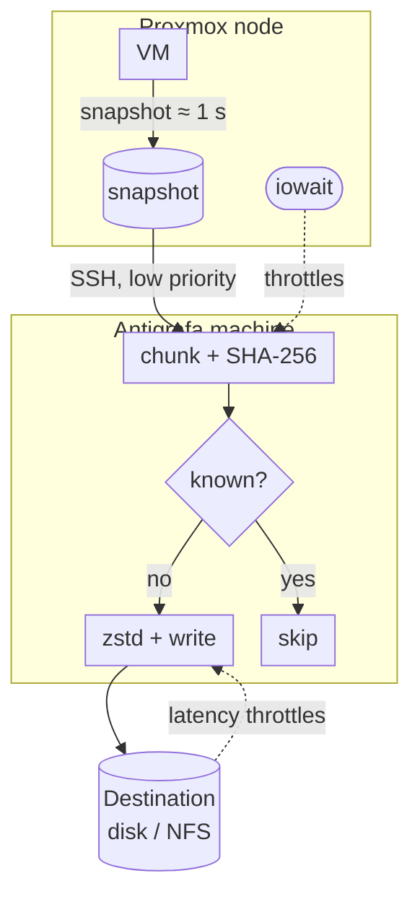

# Antigrafa

> [!WARNING]
> **Work in progress — not ready for production.** Antigrafa is under active development
> and has not yet been tested against a real Proxmox cluster. Do not rely on it as your
> only backup. See [ROADMAP.md](ROADMAP.md) for known limitations.

Backups of Proxmox VE virtual machines and containers, run from a separate machine,
that **never slow down the guests**, with a throughput that adapts to the destination
and to the load on the nodes.

## Why not just PBS?

With Proxmox Backup Server, a VM backup runs inside QEMU using *copy-before-write*:
when the VM writes to a block that has not been backed up yet, QEMU must first send
the old content to PBS. If the destination is slow, **the VM's writes wait for the
destination** and the VM stops responding. *Fleecing* (Proxmox 8.2+) mitigates this
without removing it.

## How Antigrafa works: capture and transfer are separate



1. **Capture**: snapshot through the Proxmox API, consistent across all disks.
   Filesystems are frozen through the qemu-guest-agent when it is enabled. The VM
   resumes right away.
2. **Transfer**: Antigrafa reads the snapshot over SSH. If the destination slows down,
   only the backup slows down: the VM is never in the loop.
3. **Cleanup**: the snapshot is deleted in every case, success or failure.

The trade-off: the snapshot takes space on the source storage for as long as the
transfer lasts.

## Adaptive control

| Side | Measured | Adjusted |
|---|---|---|
| Destination | chunk write latency | number of parallel writes (AIMD: +1 when it keeps up, ×0.7 when it saturates) |
| Destination | write time vs. compression time | zstd level: compress harder when the disk is slow, less when the CPU is the bottleneck |
| Source | node iowait (API `/nodes/{node}/status`) | read rate cap: halved when iowait rises, +25% when it drops |
| Source | — | reads run under `ionice -c2 -n7 nice -n10` |

The destination is shared: a single controller drives every concurrent backup that
writes to it.

## Supported storage

| Proxmox storage | VM | Container |
|---|---|---|
| ZFS (`zfspool`) | zvol, raw image | `subvol-*` dataset, tar archive |
| Ceph RBD (hyperconverged or external) | `rbd export`, raw image | raw image |
| LVM-thin | `snap_<vol>_<snap>` snapshot, raw image | raw image |
| qcow2 on directory, NFS or CIFS | not yet | — |

Disks flagged `backup=0` are skipped. For containers, only `rootfs` and mount points
flagged `backup=1` are backed up, matching Proxmox's behaviour.

## Installation

```sh
python3 -m venv /opt/antigrafa && /opt/antigrafa/bin/pip install .
cp antigrafa.example.toml /etc/antigrafa/antigrafa.toml
```

Requires Python 3.11 or later. On Python 3.14+, zstd comes from the standard library
and the project has no dependencies.

**On the Proxmox side:**
- an API token with at least `VM.Audit`, `VM.Snapshot` and `Sys.Audit`, plus read
  access to the storage configuration (`/storage`). These permissions still need to be
  validated on a real cluster;
- an SSH key from the Antigrafa machine in `/root/.ssh/authorized_keys` on every node.

## Usage

```sh
antigrafa guests                          # VMs and CTs found in the cluster
antigrafa backup --all --target nas       # back up everything
antigrafa backup --vmid 100 101 --target local
antigrafa list --target nas
antigrafa verify --target nas             # re-read every chunk and check its digest
antigrafa restore --target nas vm/100/2026-11-17T22-30-00Z scsi0 /tmp/scsi0.raw
```

## Repository format

```
<destination>/
  .chunks/<4 hex>/<sha256>          chunk (header + raw or zstd), shared by every backup
  vm/<vmid>/<timestamp>/
    manifest.json                    written last: its presence means the backup is complete
    scsi0.img.fidx                   index: size + ordered list of digests
  ct/<vmid>/<timestamp>/
    rootfs.tar.fidx
```

## Development

```sh
python3 -m venv .venv && .venv/bin/pip install -e '.[dev]'
.venv/bin/pytest                        # tests + coverage (coverage.xml)
.venv/bin/bandit -c pyproject.toml -r src   # security analysis
```

A full SonarQube analysis (tests, bandit, quality and security) runs in a throwaway
Docker instance: see [tools/sonarqube/README.md](tools/sonarqube/README.md).

## Roadmap

See [ROADMAP.md](ROADMAP.md).
